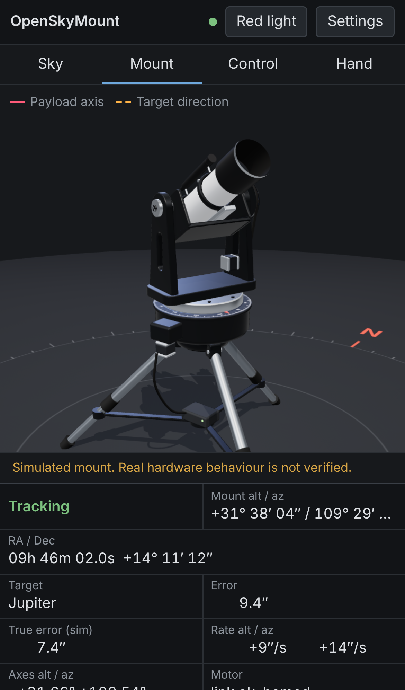
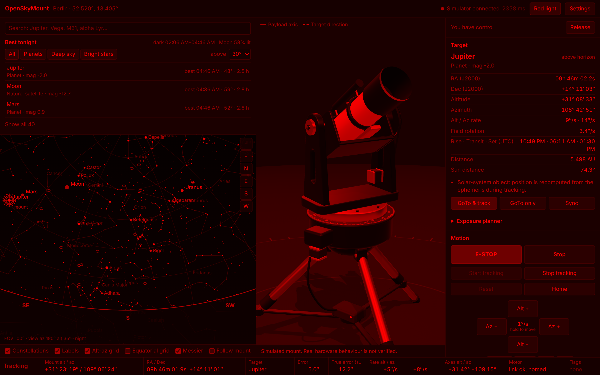

# OpenSkyMount

[](https://github.com/skynightgamer/OpenSkyMount/actions/workflows/ci.yml)

Open-source, local-first control software for a modular motorized **alt-azimuth** mount that carries a
smartphone, camera, telephoto lens or small telescope. You pick a star or planet on an interactive sky map in a
browser, and the mount slews to it and tracks it. Any phone, tablet or laptop on the same network can watch or
control it.

**Status: software prototype.** No physical hardware exists yet. Everything runs against a realistic **simulated
mount**, so behaviour on real hardware is *not verified*. See [docs/PROGRESS.md](docs/PROGRESS.md) and
[docs/TEST_RESULTS.md](docs/TEST_RESULTS.md).


<table>
  <tr>
    <td width="34%"></td>
    <td></td>
  </tr>
  <tr>
    <td>A phone watching the same mount live</td>
    <td>Red-light mode for use at the telescope</td>
  </tr>
</table>

<sub>Screenshots from the simulator (telescope payload, Berlin, 1 Nov 2026 02:00), regenerated with
<code>frontend/e2e/readme-shots.cjs</code>.</sub>

## What works today (verified by automated tests)

- **Sky map**: 41,411 stars to magnitude 8 (the faint ones load when you zoom in), constellation lines, Messier objects, Sun, Moon and
  planets, alt-az and equatorial grids, horizon, zoom and pan by mouse or touch, search (e.g. "Jupiter", "Vega",
  "alpha Lyr", "M31"), and object details: RA/Dec, Alt/Az, rise, transit and set times, rates, and field rotation.
- **Accurate astronomy**: Skyfield and the JPL DE421 ephemeris, fully offline. Results are checked against worked
  examples from Meeus' *Astronomical Algorithms* and cross-checked against Astropy (stars agree within 5″). Star
  positions use Hipparcos-2 astrometry with proper motion and parallax.
- **Virtual mount**: 3D model with five payload shapes. The physics model covers acceleration and speed limits,
  backlash, command latency, encoder noise, base tilt and zero-point errors, travel and cable-wrap limits, and
  fault injection.
- **GoTo and tracking**: continuous tracking in real or accelerated time (up to 3600×). Steady-state error is about
  2″ in simulation. The controller handles azimuth wrap-around and automatic cable unwinding, the zenith keyhole,
  objects rising and setting, and jumps in time.
- **Safety policy**: the Sun is blocked by default, with a 15° solar exclusion zone. Software E-stop is available
  from every client and takes precedence over everything else. Manual slewing has a dead-man timer, and firmware
  soft limits are enforced.
- **Alignment model**: Sync on stars (or plate-solve) to build a pointing model. One star corrects the axis zero
  offsets; three or more also correct a tilted base. In simulation, three stars bring a 0.6°-misaligned, tilted
  mount below 72″ across the sky.
- **Observing planner**: tonight's darkness window and the best targets in it, ranked for small optics.
- **Exposure planner**: longest exposure before field rotation (on this mount) or star trailing (fixed tripod) blurs
  the image, for presets from a smartphone to a small telescope.
- **Red-light mode** for use at the telescope (whole interface rendered in pure red to preserve dark adaptation).
- **Multi-device**: WebSocket state sync. One client holds control authority at a time; the others observe.
  Commands carry sequence numbers, so stale ones are rejected.
- **Hardware path**: an OSM/1 line protocol, a *fake firmware* TCP endpoint and a protocol driver. Integration
  tests run the controller over real TCP.
- **ASCOM Alpaca Telescope device** (`/api/v1/telescope/0`, discovery on UDP 32227): Alpaca clients can read the
  position and send GoTo, Sync, Tracking and AbortSlew, under the same control authority and safety rules as the UI.
  Tested with the alpyca client; not yet with N.I.N.A. or Stellarium. See [docs/alpaca.md](docs/alpaca.md).
- **Observing sessions**: a target queue the mount works through on its own (GoTo, track for a set time or until the
  next start time, next). Refused or setting targets are skipped with the reason; any other motion command pauses it.
- **Satellites, comets and asteroids** from user-supplied TLEs and MPC orbit lines (offline; nothing is
  downloaded). Pass predictions, and fast satellite tracking: a 70° ISS pass is followed within 30″ (true error) in
  simulation, with the cable wrap planned for the whole pass.
- **Telemetry recording and replay**: JSONL logs of pointing, target, rates and errors with an in-browser replay
  (error chart, scrubber, per-target statistics, CSV export).
- **Gamepad and phone use**: manual slews from a game controller (hold LB/RB as the dead man), a large
  hand-controller layout for phones, and a home-screen web app (manifest; service worker on localhost/HTTPS).
  See [docs/observing.md](docs/observing.md).
- **Experimental plate solving**: synthetic camera frames are solved with tetra3/cedar-solve, and the measured
  position is added to the alignment model.

## Quick start

Requirements: Python ≥ 3.11, Node.js ≥ 18 (only needed to build the UI), git.

```bash
git clone https://github.com/skynightgamer/OpenSkyMount.git
cd OpenSkyMount
scripts/setup.sh          # creates backend/.venv, installs deps, builds the web UI
scripts/run.sh            # http://localhost:8000
```

To let other devices on your Wi-Fi watch or control the mount:

```bash
OPENSKYMOUNT_PASSWORD='choose-a-password' scripts/run.sh --lan   # then open http://<your-computer-ip>:8000
```

With a password set, every device has to log in first (the session is kept in a cookie). E-STOP on the login
screen works without the password. The connection is plain HTTP, so this keeps other people on your network away
from the controls but is no protection against a hostile network. Without a password the server prints a warning
when it listens on the network.

Angles (sexagesimal or decimal) and the time zone used for all times are set per device under
**Settings → Display**.

Try it out:

1. Open the settings (⚙) and set your location. Using the browser's location is optional.
2. Click **Take control**.
3. Search for **Jupiter**. If it is below the horizon, pick another object or set a night-time date in the clock
   panel.
4. Press **GoTo & track** and watch the 3D mount slew and then track. Use ×60 or ×600 to speed up time.
5. Open a second browser window or phone. It shows the same live state, and **E-STOP** works from any client.

### Use it from N.I.N.A. and other astronomy software (ASCOM Alpaca)

OpenSkyMount is also an ASCOM Alpaca **Telescope** device: in N.I.N.A. (or any Alpaca client) add an Alpaca
telescope at the server's address and port (default `127.0.0.1:8000`, device 0), or let the client discover it when
the server runs with `--lan`. Coordinates are "JNow". The program then appears in the web UI's client list and
follows the same control and safety rules. In password mode the client logs in with HTTP Basic (any user name, the
OpenSkyMount password). Tested with the alpyca client only so far. Details and limits: [docs/alpaca.md](docs/alpaca.md).

Headless demo (no browser):

```bash
backend/.venv/bin/python examples/headless_demo.py
```

### Development

```bash
# backend with auto-reload is not needed; restart after changes:
backend/.venv/bin/python -m openskymount.server            # API + built UI on :8000
cd frontend && npm run dev                                   # Vite dev server on :5173 (proxies /api, /ws)
scripts/test.sh            # ruff + mypy + pytest + tsc + vitest   (--e2e adds the browser tests)
scripts/e2e.sh             # browser tests only (builds the UI, starts two servers, runs Playwright)
```

Every push runs the same checks in [GitHub Actions](.github/workflows/ci.yml): backend on Python 3.11 and 3.13
(with the optional extras), frontend type check, unit tests and build, and the browser tests.

Optional extras:
- `pip install astropy` enables the independent astronomy cross-check tests.
- `pip install --no-deps cedar-solve scipy pillow` enables the plate-solving proof of concept.

Simulated microcontroller over TCP (exercises the real hardware code path):

```bash
backend/.venv/bin/openskymount-fake-firmware --port 7624 &
backend/.venv/bin/python -m openskymount.server --driver tcp://127.0.0.1:7624
```

## Repository layout

```
backend/openskymount/   Python package (FastAPI server, astronomy, controller, drivers, simulator, solver)
  astro/                Skyfield engine, bundled catalog search, user-supplied orbital elements (TLE, MPC)
  mount/                driver interface, simulator, controller, session sequencer, OSM/1 protocol, fake firmware
  server/               REST + WebSocket app, control-authority sessions, ASCOM Alpaca device, telemetry recorder
  solve/                experimental plate solving
  data/                 catalog.json (generated by scripts/build_catalog.py) + license
backend/tests/          pytest suite (astronomy references, motion, controller, server, Alpaca, protocol, solver)
frontend/               React + TypeScript + Three.js web UI (sky map, 3D mount, controls), e2e/ browser tests
firmware/               notes for the future ESP32 firmware (protocol contract)
docs/                   architecture, decisions, safety, hardware roadmap, progress, test results
examples/ scripts/      demo, setup/run/test helpers
.github/workflows/      CI (GitHub Actions)
```

## Documentation

- [Architecture and technology choices](docs/architecture.md)
- [Configuration](docs/configuration.md) and [simulation guide](docs/simulation.md)
- [Safety](docs/safety.md), which covers solar safety, emergency stop and hardware duties
- [Hardware roadmap and bill of materials](docs/hardware.md), plus the [OSM/1 protocol](firmware/README.md)
- [ASCOM Alpaca](docs/alpaca.md): connecting N.I.N.A. and other Alpaca clients
- [Observing sessions, satellites/comets, recordings, gamepad and phone use](docs/observing.md)
- [Known limitations](docs/limitations.md)
- Progress tracking: [PROGRESS](docs/PROGRESS.md) · [NEXT_TASKS](docs/NEXT_TASKS.md) ·
  [DECISIONS](docs/DECISIONS.md) · [TEST_RESULTS](docs/TEST_RESULTS.md)

## License

MIT for this project (see [LICENSE](LICENSE)). Bundled data and dependencies are covered in
[THIRD_PARTY_NOTICES.md](THIRD_PARTY_NOTICES.md).
