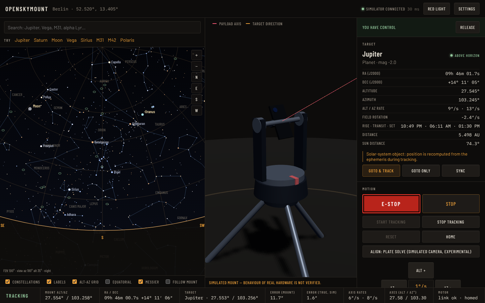

# OpenSkyMount

Open-source, local-first control software for a modular motorized **alt-azimuth** mount that carries a
smartphone, camera, telephoto lens or small telescope. You pick a star or planet on an interactive sky map in a
browser, and the mount slews to it and tracks it. Any phone, tablet or laptop on the same network can watch or
control it.

**Status: software prototype.** No physical hardware exists yet. Everything runs against a realistic **simulated
mount**, so behaviour on real hardware is *not verified*. See [docs/PROGRESS.md](docs/PROGRESS.md) and
[docs/TEST_RESULTS.md](docs/TEST_RESULTS.md).



## What works today (verified by automated tests)

- **Sky map**: stars to magnitude 6 (5044 Hipparcos stars), constellation lines, Messier objects, Sun, Moon and
  planets, alt-az and equatorial grids, horizon, zoom and pan by mouse or touch, search (e.g. "Jupiter", "Vega",
  "alpha Lyr", "M31"), and object details: RA/Dec, Alt/Az, rise, transit and set times, rates, and field rotation.
- **Accurate astronomy**: Skyfield and the JPL DE421 ephemeris, fully offline. Results are checked against worked
  examples from Meeus' *Astronomical Algorithms* and cross-checked against Astropy (stars agree within 5″).
- **Virtual mount**: 3D model with five payload shapes. The physics model covers acceleration and speed limits,
  backlash, command latency, encoder noise, base tilt and zero-point errors, travel and cable-wrap limits, and
  fault injection.
- **GoTo and tracking**: continuous tracking in real or accelerated time (up to 3600×). Steady-state error is about
  2″ in simulation. The controller handles azimuth wrap-around and automatic cable unwinding, the zenith keyhole,
  objects rising and setting, and jumps in time.
- **Safety policy**: the Sun is blocked by default, with a 15° solar exclusion zone. Software E-stop is available
  from every client and takes precedence over everything else. Manual slewing has a dead-man timer, and firmware
  soft limits are enforced.
- **Red-light mode** for use at the telescope (whole interface rendered in pure red to preserve dark adaptation).
- **Multi-device**: WebSocket state sync. One client holds control authority at a time; the others observe.
  Commands carry sequence numbers, so stale ones are rejected.
- **Hardware path**: an OSM/1 line protocol, a *fake firmware* TCP endpoint and a protocol driver. Integration
  tests run the controller over real TCP.
- **Experimental plate solving**: synthetic camera frames are solved with tetra3/cedar-solve, and the measured
  pointing error is fed back into the pointing model.

## Quick start

Requirements: Python ≥ 3.11, Node.js ≥ 18 (only needed to build the UI), git.

```bash
git clone https://github.com/skynightgamer/OpenSkyMount.git
cd OpenSkyMount
scripts/setup.sh          # creates backend/.venv, installs deps, builds the web UI
scripts/run.sh            # http://localhost:8000
```

To let other devices on your Wi-Fi watch or control the mount:

```bash
scripts/run.sh --lan      # then open http://<your-computer-ip>:8000 on the phone/tablet
```

Try it out:

1. Open the settings (⚙) and set your location. Using the browser's location is optional.
2. Click **Take control**.
3. Search for **Jupiter**. If it is below the horizon, pick another object or set a night-time date in the clock
   panel.
4. Press **GoTo & track** and watch the 3D mount slew and then track. Use ×60 or ×600 to speed up time.
5. Open a second browser window or phone. It shows the same live state, and **E-STOP** works from any client.

Headless demo (no browser):

```bash
backend/.venv/bin/python examples/headless_demo.py
```

### Development

```bash
# backend with auto-reload is not needed; restart after changes:
backend/.venv/bin/python -m openskymount.server            # API + built UI on :8000
cd frontend && npm run dev                                   # Vite dev server on :5173 (proxies /api, /ws)
scripts/test.sh            # ruff + mypy + pytest + tsc + vitest   (--e2e adds the browser test)
```

Optional extras:
- `pip install astropy` enables the independent astronomy cross-check tests.
- `pip install --no-deps cedar-solve scipy pillow` enables the plate-solving proof of concept.

Simulated microcontroller over TCP (exercises the real hardware code path):

```bash
backend/.venv/bin/openskymount-fake-firmware --port 7624 &
backend/.venv/bin/python -m openskymount.server --driver tcp://127.0.0.1:7624
```

## Repository layout

```
backend/openskymount/   Python package (FastAPI server, astronomy, controller, drivers, simulator, solver)
  astro/                Skyfield engine + bundled catalog search
  mount/                driver interface, simulator, controller, OSM/1 protocol, fake firmware
  server/               REST + WebSocket app, control-authority sessions
  solve/                experimental plate solving
  data/                 catalog.json (generated by scripts/build_catalog.py) + license
backend/tests/          pytest suite (astronomy references, motion, controller, server, protocol, solver)
frontend/               React + TypeScript + Three.js web UI (sky map, 3D mount, controls), e2e/ browser test
firmware/               notes for the future ESP32 firmware (protocol contract)
docs/                   architecture, decisions, safety, hardware roadmap, progress, test results
examples/ scripts/      demo, setup/run/test helpers
```

## Documentation

- [Architecture and technology choices](docs/architecture.md)
- [Configuration](docs/configuration.md) and [simulation guide](docs/simulation.md)
- [Safety](docs/safety.md), which covers solar safety, emergency stop and hardware duties
- [Hardware roadmap and bill of materials](docs/hardware.md), plus the [OSM/1 protocol](firmware/README.md)
- [Known limitations](docs/limitations.md)
- Progress tracking: [PROGRESS](docs/PROGRESS.md) · [NEXT_TASKS](docs/NEXT_TASKS.md) ·
  [DECISIONS](docs/DECISIONS.md) · [TEST_RESULTS](docs/TEST_RESULTS.md)

## License

MIT for this project (see [LICENSE](LICENSE)). Bundled data and dependencies are covered in
[THIRD_PARTY_NOTICES.md](THIRD_PARTY_NOTICES.md).
