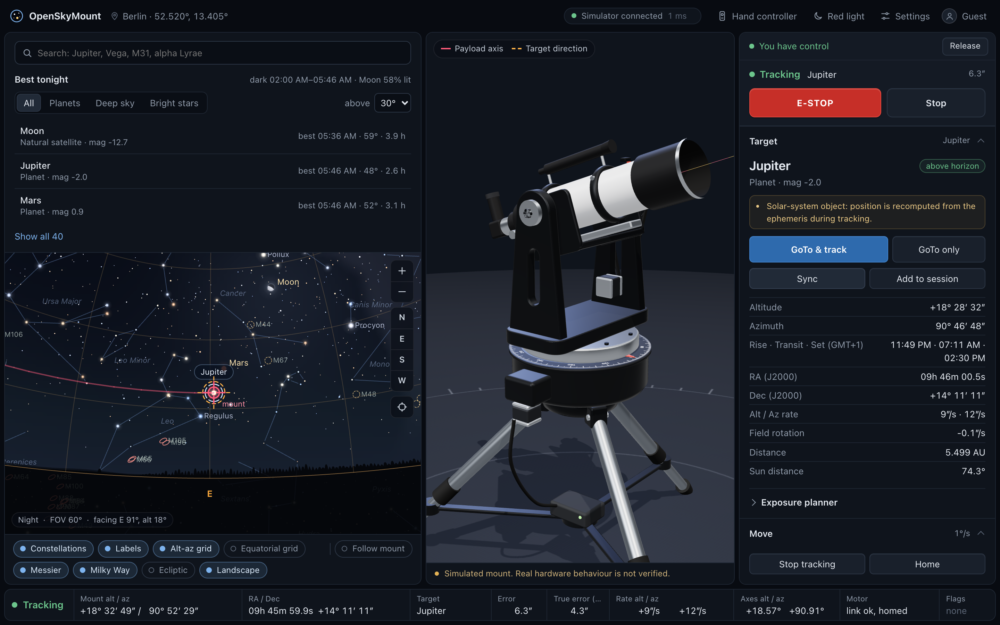

# OpenSkyMount

[](https://github.com/skynightgamer/OpenSkyMount/actions/workflows/ci.yml)

OpenSkyMount is local-first software for controlling a modular alt-azimuth astronomy mount from a browser. Explore the sky, point and track targets, and share a live view across devices.

**Status: software prototype.** The mount is simulated; no physical hardware exists yet, and real-hardware behaviour has not been verified.



## Quick start

Requires Python 3.11 or newer, Node.js 18 or newer, and Git.

```bash
git clone https://github.com/skynightgamer/OpenSkyMount.git
cd OpenSkyMount
scripts/setup.sh          # install dependencies and build the UI
scripts/run.sh            # open http://localhost:8000
```

On first launch, the optional setup guide walks through choosing a location and payload, taking control, and tracking a target. Reopen the guide from the account menu. Drag its header to move it.

To connect from other devices, create an admin account on the server computer first, then run `scripts/run.sh --lan`. Alternatively, set `OPENSKYMOUNT_PASSWORD` to use a shared password. LAN access uses plain HTTP; use a trusted network. E-STOP remains available to every client, including before sign-in. See [configuration](docs/configuration.md) for details.

## Features

- Interactive offline sky map with stars, planets, constellation art you can click (with English names and a short story each), search, zoom and observing details, and a sky events calendar (eclipses, conjunctions, meteor showers, oppositions).
- Simulated mount with GoTo, tracking, guided star alignment, a slew preview (time, axis turns, cable wrap), safety limits and a 3D view.
- Observing queues (including mosaic and timelapse planning for a phone or camera), satellites and comets from supplied orbital elements, telemetry recording and replay, gamepad support, and a phone layout.
- Multi-device control, optional accounts, a dimmable red-light night mode, and an ASCOM Alpaca interface. The OnStepX adapter and plate solving are experimental.

## Development

```bash
scripts/test.sh            # backend lint, types and tests; frontend types and tests
scripts/test.sh --e2e      # also run browser tests (requires Playwright and Chromium)
cd frontend && npm run dev # UI development server on :5173
```

See [architecture](docs/architecture.md), [simulation](docs/simulation.md), [safety](docs/safety.md), [hardware roadmap](docs/hardware.md), [Alpaca](docs/alpaca.md), [observing features](docs/observing.md), and [known limitations](docs/limitations.md). Current work and test history are in [progress](docs/PROGRESS.md), [next tasks](docs/NEXT_TASKS.md), and [test results](docs/TEST_RESULTS.md).

## License

MIT; see [LICENSE](LICENSE). Bundled data and dependencies are covered by [third-party notices](THIRD_PARTY_NOTICES.md), including the Stellarium constellation artwork notice in [frontend/public/figures](frontend/public/figures/NOTICE.md).
